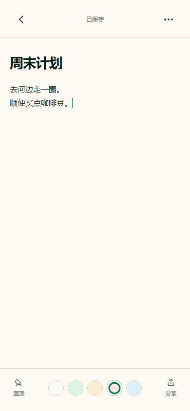
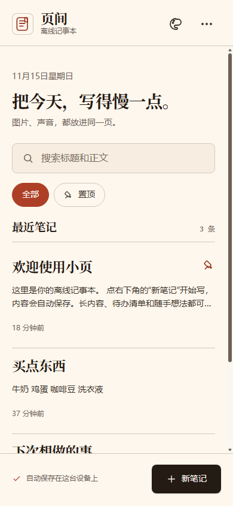
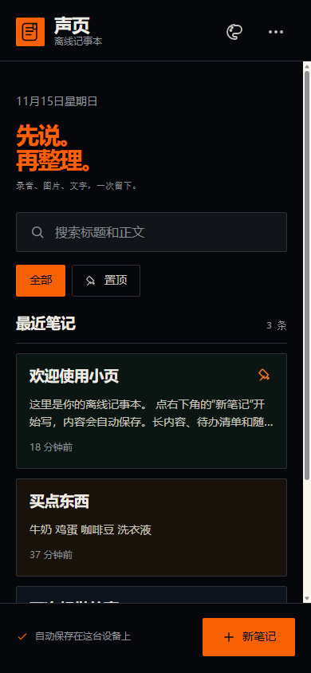
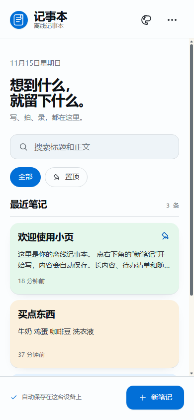

# 记事本

应用内的名字是“小页”，这是一个手机优先的离线记事本。数据保存在当前设备的应用存储里，不上传服务器。

安卓安装包：[xiaoye-notepad.apk](./xiaoye-notepad.apk)

## 功能

- 新建、编辑、删除和撤销删除
- 正文自动保存
- 搜索标题和正文
- 置顶笔记
- 页间、声页、白页三套可切换界面
- 从相册插入多张图片，预览和移除
- 录制语音笔记、查看波形和回放
- Markdown 分享或导出
- 全部笔记 JSON 备份
- PWA 离线缓存
- Android WebView APK

## 界面预览










## 直接使用网页版

在 `xiaoye-app` 目录启动任意静态文件服务器，例如：

```powershell
python -m http.server 4173
```

然后打开 `http://127.0.0.1:4173/`。手机和电脑在同一局域网时，也可以用电脑的局域网地址访问。

在 Chrome、Edge 或 Safari 中打开后，可以选择“安装应用”或“添加到主屏幕”。安装后可以像普通 App 一样从主屏幕启动。

## Android APK

`xiaoye-notepad.apk` 是可直接安装的调试签名 APK，当前版本 2.0.2，支持 Android 6.0 及以上。

APK 采用本地 WebView，不请求网络权限。录音时 Android 会请求麦克风权限。笔记和媒体附件保存在应用本地，卸载应用或清除应用数据会删除笔记，建议定期使用“备份全部笔记”导出文字内容。

## 注意

- 这是本地单机记事本，没有账号同步。
- 浏览器版和 APK 的数据彼此独立。
- 清除浏览器站点数据或 Android 应用数据会删除笔记。
- JSON 备份目前包含文字和附件索引，但不打包图片、录音的二进制内容。
- 从 1.0.0 升级到新版本时，应用会自动迁移旧版本地笔记。

## 开源许可

本项目使用 [MIT License](./LICENSE)，允许复制、修改、分发和商业使用。保留版权与许可声明即可。
